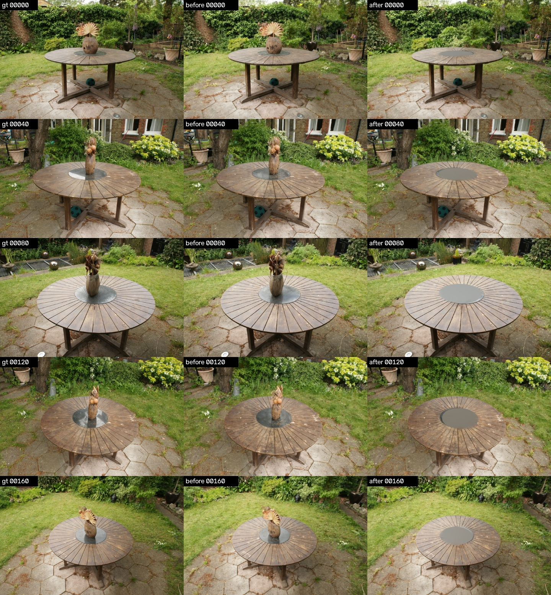
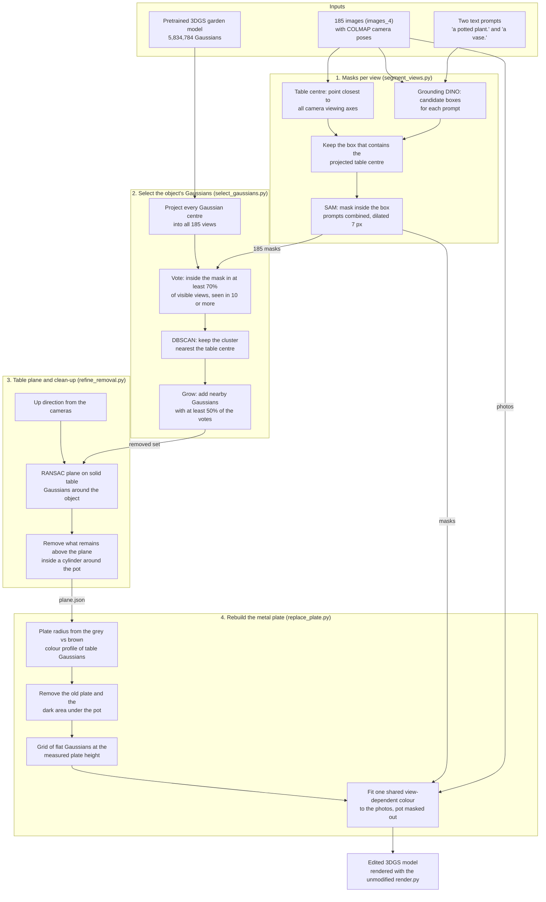

# Removing the plant and pot from the 3DGS garden scene

In this task, I removed the potted plant from the table in the `garden` scene of the 3D Gaussian Splatting paper (Kerbl et al. 2023) and filled the resulting hole, entirely in code. The only inputs are:
the pretrained 3DGS model
the original Mip-NeRF 360 images and camera poses
two text prompts



Columns, left to right: original photo, render of the pretrained model, render after editing.

## 1. Folder layout

The scripts assume this layout. Everything lives in one parent folder (`wimmer-task/` here).

```text
wimmer-task/
  gaussian-splatting/   official 3DGS code (cloned in step 3)
  downloads/            zip files (step 4)
  models/garden/        pretrained garden model (step 4)
  data/garden/          Mip-NeRF 360 garden images and COLMAP poses (step 4)
  solution/             this task (Assigned by Dr Wimmer)
  outputs/              everything the pipeline writes
```

## 2. System and hardware

Tested on:

| Item | Version |
|---|---|
| OS | Ubuntu 24.04.5 LTS |
| Machine | Dell XPS 15 9520, 32 GB RAM |
| GPU | NVIDIA RTX 3050 Laptop, 4 GB |
| Driver | 595.99.02 |
| Python | 3.10 (Miniforge) |
| PyTorch | 2.5.1 with CUDA 12.4 |
| CUDA toolkit (for compiling the 3DGS extensions) | 12.4.1 |
| transformers | 4.46.3 |
| 3DGS commit | `<output of git -C gaussian-splatting rev-parse HEAD>` |

##System Limitation:
A CUDA GPU is needed for segmentation, rendering and the plate fit. Gaussian selection and plane fitting run on the CPU. Because the GPU has only 4 GB, all renders are made at half of the `images_4` resolution (`-r 2`). On a larger GPU, `-r 1` gives the full `images_4` resolution.


## 3. Environment setup

### 3.1 NVIDIA driver

Check that the driver is loaded:

```bash
nvidia-smi
```

If it fails on Ubuntu, install the recommended driver and reboot.
Steps I had to follow: 

```bash
sudo apt update
sudo apt full-upgrade -y
sudo reboot
sudo ubuntu-drivers install
sudo reboot
```

### 3.2 Conda (Miniforge)

```bash
cd ~/Downloads
wget https://github.com/conda-forge/miniforge/releases/latest/download/Miniforge3-Linux-x86_64.sh
bash Miniforge3-Linux-x86_64.sh -b -p $HOME/miniforge3
$HOME/miniforge3/bin/conda init bash
source ~/.bashrc
```

### 3.3 3DGS code

```bash
mkdir -p ~/wimmer-task && cd ~/wimmer-task
git clone https://github.com/graphdeco-inria/gaussian-splatting --recursive
```

### 3.4 Python environment and the 3DGS CUDA extensions

```bash
conda create -n gs python=3.10 -y
conda activate gs
pip install torch==2.5.1 torchvision==0.20.1 --index-url https://download.pytorch.org/whl/cu124
conda install -c "nvidia/label/cuda-12.4.1" cuda-toolkit -y
conda env config vars set CUDA_HOME=$CONDA_PREFIX TORCH_CUDA_ARCH_LIST=8.6
conda deactivate && conda activate gs

cd ~/wimmer-task/gaussian-splatting
pip install setuptools wheel ninja plyfile tqdm opencv-python joblib
pip install --no-build-isolation submodules/diff-gaussian-rasterization
pip install --no-build-isolation submodules/simple-knn
```


Notes on the build:

- `--no-build-isolation` is needed so the build can see the installed PyTorch.
- If `nvcc` rejects the system gcc (gcc 13 on Ubuntu 24.04), build with gcc 12
- If the rasterizer fails with `uint32_t` or `uintptr_t` "not declared", add the missing include and rebuild

### 3.5 Packages for this solution

```bash
pip install transformers==4.46.3 accelerate pillow scipy scikit-learn plyfile opencv-python
sudo apt install ffmpeg -y
```

`transformers` 

Only for the optional inpainting alternative in section 7:

```bash
pip install simple-lama-inpainting --no-deps
```

Alternatively, install everything from the frozen list:

```bash
pip install -r requirements_solution.txt
```

### 3.6 Check

```bash
python -c "import torch; from diff_gaussian_rasterization import GaussianRasterizer; from simple_knn._C import distCUDA2; print(torch.cuda.is_available())"
```

This should print `True`.

## 4. Data and pretrained model

`setup_data.sh` does all of this:

```bash
cd ~/wimmer-task/solution
chmod +x setup_data.sh run_all.sh
./setup_data.sh
```

The steps it runs:

```bash
mkdir -p ../downloads ../models ../data
cd ../downloads
wget -c https://repo-sam.inria.fr/fungraph/3d-gaussian-splatting/datasets/pretrained/models.zip
wget -c http://storage.googleapis.com/gresearch/refraw360/360_v2.zip
unzip -n models.zip "garden/*" -d ../models
unzip -n 360_v2.zip "garden/*" -d ../data
```

- `models.zip` (about 14 GB) contains the authors' pretrained models for all scenes; only `garden/` is extracted.
- `360_v2.zip` is the Mip-NeRF 360 dataset; only `garden/` is extracted (images at four resolutions, `sparse/0` COLMAP poses).

**Compatibility fix for the pretrained model.** The model's `cfg_args` was written in 2023 and lacks three fields that the current 3DGS code expects (`depths`, `train_test_exp`, `data_device`). The script keeps the original as `cfg_args.orig` and writes:

```text
Namespace(data_device='cpu', depths='', eval=True, images='images_4', model_path='./eval/garden', resolution=1, sh_degree=3, source_path='f:/bkerbl/Downloads/360_v2/garden', train_test_exp=False, white_background=False)
```

Only the three new fields differ from the original; `data_device='cpu'` keeps the images in system memory. The model was trained on `images_4` at that folder's full size (`resolution=1`) with the standard 1 in 8 test split (`eval=True`), so all scripts use `images_4`. The stored `source_path` is the authors' own path, so every command passes the local dataset with `-s`.

A quick check that the pretrained model renders:

```bash
cd ~/wimmer-task/gaussian-splatting
python render.py -m ../models/garden -s ../data/garden -r 2 --skip_test
```

## 5. Running the pipeline

### 5.1 Everything at once

```bash
cd ~/wimmer-task/solution
conda activate gs
./run_all.sh
```

### 5.2 Step by step

All commands are run from `solution/`, except the renders, which are run from `gaussian-splatting/`.

**Step 1: masks of the plant and pot**

```bash
python segment_views.py --source ../data/garden --images ../data/garden/images_4 --out ../outputs/seg
```

Defaults: prompts `"a potted plant.|a vase."`, box threshold 0.2, text threshold 0.25, anchor margin 0.15, mask dilation 7 px.

**Step 2: select the object's Gaussians**

```bash
python select_gaussians.py --source ../data/garden \
  --ply ../models/garden/point_cloud/iteration_30000/point_cloud.ply \
  --masks ../outputs/seg/masks --out ../outputs/select \
  --model_in ../models/garden --model_out ../models/garden_removed
```

Defaults: vote ratio 0.7, growing ratio 0.5, at least 10 views, cluster distance 1% of the camera orbit radius, mask area tolerance 2.5.

**Step 3: fit the table plane and clean up what remains of the pot**

```bash
python refine_removal.py --source ../data/garden \
  --ply ../models/garden/point_cloud/iteration_30000/point_cloud.ply \
  --removed ../outputs/select/removed_idx.npy --out ../outputs/refine \
  --model_in ../models/garden --model_out ../models/garden_removed2
```

**Step 4: replace the metal plate**

```bash
python replace_plate.py --source ../data/garden --masks ../outputs/seg/masks \
  --model_in ../models/garden_removed2 --model_out ../models/garden_final \
  --plane ../outputs/refine/plane.json --out ../outputs/plate \
  --mask_dilate 20 --loss l2
```

**Step 5: render and compare**

```bash
cd ../gaussian-splatting
python render.py -m ../models/garden -s ../data/garden -r 2 --skip_test
python render.py -m ../models/garden_final -s ../data/garden -r 2 --skip_test

cd ../solution
python compare_views.py \
  --columns gt=../models/garden/train/ours_30000/gt \
            before=../models/garden/train/ours_30000/renders \
            after=../models/garden_final/train/ours_30000/renders \
  --out ../outputs/compare/final.jpg
```

**Step 6: before and after video**

```bash
mkdir -p ../outputs/video
ffmpeg -y -framerate 12 -i ../models/garden/train/ours_30000/renders/%05d.png \
       -framerate 12 -i ../models/garden_final/train/ours_30000/renders/%05d.png \
       -filter_complex "[0:v][1:v]hstack=inputs=2,scale=trunc(iw/2)*2:trunc(ih/2)*2" \
       -c:v libx264 -pix_fmt yuv420p ../outputs/video/before_after.mp4
```


## 7. Approaches I tried

These scripts are kept in the repository so the results can be compared.

1. **Single prompt, top-scoring box.** Marked background plants in about half the views. Replaced by the table-centre rule in 6.1.
2. **Filling only the hole** (`fill_hole.py`). New flat Gaussians in a disk slightly larger than the pot base.
   - Colour from a single top-down render, inpainted: too dark, because the plate is shiny and looks darker from above than from the side.
   - Copying the colour coefficients from the ring at the same angle: a pinwheel of light and dark wedges.
   - A harmonic fill, which solves the Laplace equation for every colour coefficient with the surrounding plate as boundary: smooth, but slightly foggy, and it sat below the plate, which looked like a shallow bowl. Placing it at the measured plate height fixed the bowl.
3. **Per-view shade optimisation** (`refine_fill.py`). The colour coefficients of the fill were optimised so that in each view the fill matches the median colour of the plate in a ring around it. This gave the right metallic shade, but a thin seam remained where the fill met the real plate. That led to the final method of replacing the whole plate.

To reproduce the hole-filling alternative:

```bash
python fill_hole.py --model_in ../models/garden_removed2 --model_out ../models/garden_filled \
  --plane ../outputs/refine/plane.json --out ../outputs/fill --clear_band 0.5 --overlap 0.9
python refine_fill.py --source ../data/garden --model_in ../models/garden_filled \
  --model_out ../models/garden_filled_opt --plane ../outputs/refine/plane.json \
  --fill ../outputs/fill/fill.json --out ../outputs/refine_fill
```

`fill_hole.py --appearance inpaint` uses LaMa (or OpenCV with `--inpaint opencv`) on the top-down view instead of the harmonic fill.

## 8. Outputs

| Path | Content |
|---|---|
| `outputs/seg/masks/` | One mask per view |
| `outputs/seg/overlay_sheet.jpg` | All masks on one sheet, with the table-centre point in yellow |
| `outputs/seg/segmentation_log.json` | Boxes, scores and parameters per view |
| `outputs/select/removed_idx.npy`, `selection_stats.json`, `removed_only.ply` | Selected Gaussians and statistics |
| `outputs/refine/plane.json`, `column_only.ply` | Table plane, footprint, clean-up |
| `outputs/plate/plate.json`, `check_*.png` | Plate radius, height, and photo versus render checks |
| `outputs/compare/final.jpg` | Photo, original render, edited render for five views |
| `outputs/video/before_after.mp4` | Original and edited renders side by side |
| `models/garden_final/` | The edited 3DGS model: `<Drive link>` |


## 9. Inputs and permissions

As discussed in the email, you confirmed that the pretrained garden model from the 3DGS paper may be used, that pretrained 2D models may be used, and that a text prompt is acceptable as the only input for identifying the object. Beyond the downloaded data, the pipeline uses no manual input: the two prompts are the only object-specific input, and everything else is computed from the images, the camera poses and the model.

## 10. AI assistance

few parts of the code were written with the help of an AI assistant. I reviewed, tested and can explain all of it.

## 11. Credits

- 3D Gaussian Splatting: Kerbl, Kopanas, Leimkühler, Drettakis, ACM TOG 2023. Code and pretrained models from the authors' repository.
- Mip-NeRF 360 dataset: Barron et al., CVPR 2022.
- Grounding DINO: Liu et al., 2023.
- Segment Anything: Kirillov et al., 2023.
- LaMa (optional inpainting): Suvorov et al., 2022.

Each is used under its own licence.
